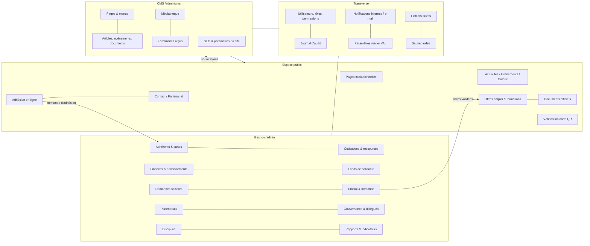
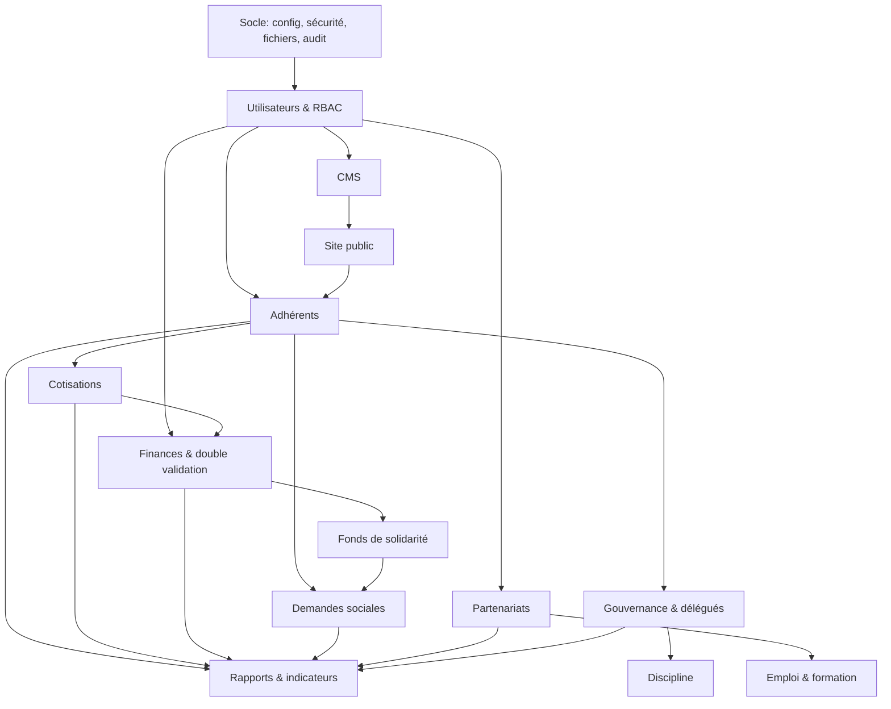
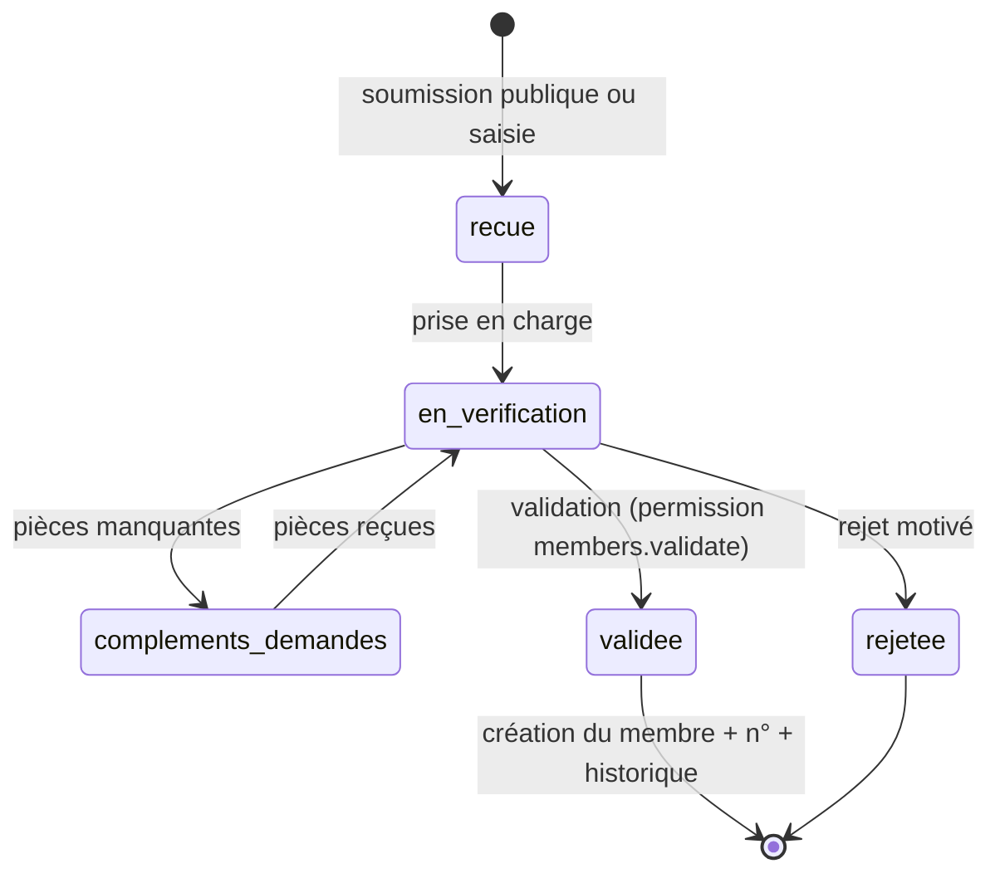
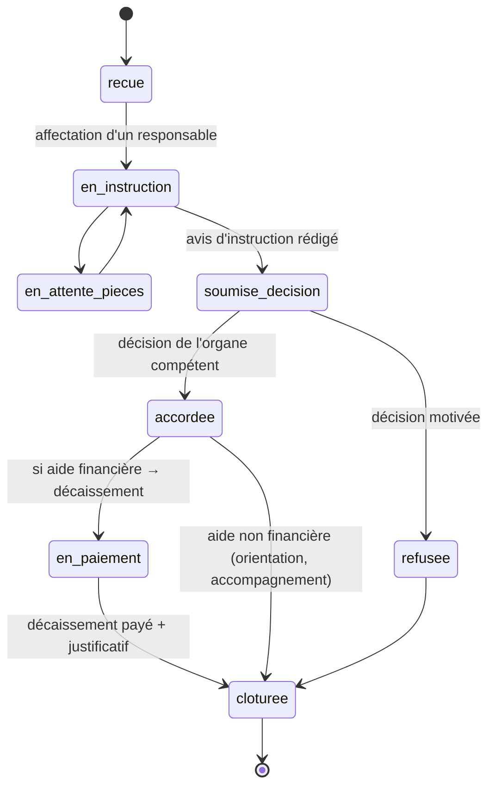
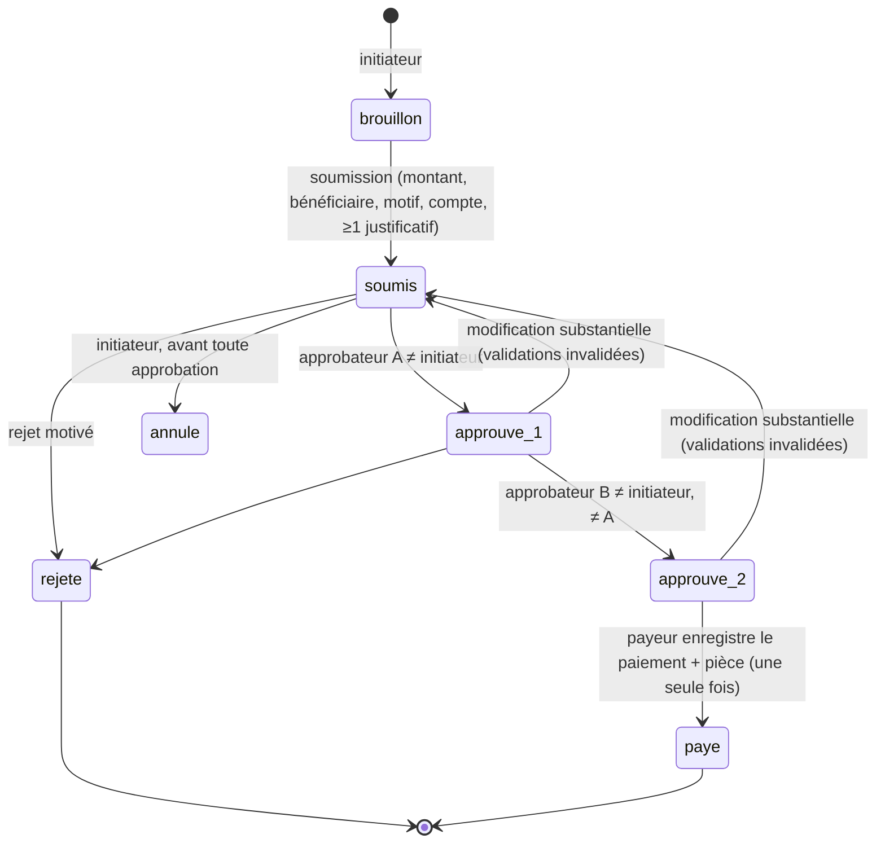

# 03 — Architecture fonctionnelle et technique

> Statut : **proposition soumise à validation**. Les diagrammes sont en Mermaid (rendus par GitHub).

## Partie A — Architecture fonctionnelle

### A1. Vue d'ensemble



Une seule application, une seule base, un seul système de comptes. CMS et gestion partagent l'enveloppe d'administration (`/admin`) ; le menu affiché dépend des permissions.

### A2. Arborescence du site public

```
/                               Accueil
/la-mutuelle                    Présentation
  /la-mutuelle/historique       Historique et vision
  /la-mutuelle/missions         Missions et objectifs
  /la-mutuelle/gouvernance      Organisation et gouvernance
/actions-sociales               Nos actions sociales
  /actions-sociales/fonds-de-solidarite
/adhesion                       Conditions + formulaire en ligne (multi-étapes)
/emploi                         Offres d'emploi et d'embarquement  (/emploi/{slug})
/formation                      Formation professionnelle           (/formation/{slug})
/partenaires                    Partenaires
/actualites                     Actualités  (/actualites/{slug}, /actualites/categorie/{slug})
/evenements                     Événements  (/evenements/{slug})
/documents                      Documents officiels
/galerie                        Galerie photos (/galerie/{album})
/contact                        Contact (+ proposition de partenariat)
/mentions-legales
/confidentialite
/verifier/{jeton}               Vérification carte de membre (QR)
/sitemap.xml  /robots.txt
```

Toutes les pages sont des pages CMS (gabarit + blocs) ; les listes (actualités, offres…) sont alimentées par leurs modules. Le menu principal est un menu CMS.

### A3. Cartographie des modules et dépendances



### A4. Parcours utilisateurs principaux

| Parcours | Acteur | Étapes |
|---|---|---|
| U1 Demander son adhésion | Visiteur (mobile) | Accueil → « Adhérer » → étape 1 identité → 2 profession → 3 ayants droit (si activé) → 4 pièces → récapitulatif → accusé de réception avec référence |
| U2 Valider une demande | Gestionnaire adhérents | Tableau de bord « demandes en attente » → dossier → contrôle des pièces → Valider (n° attribué) / Rejeter (motif obligatoire) / Compléments demandés |
| U3 Encaisser une cotisation | Trésorerie | Recherche membre → onglet cotisations → « Enregistrer un paiement » → mode, référence, date → reçu PDF |
| U4 Instruire une aide | Gestionnaire social → organe | Demande reçue → affectation → avis d'instruction → décision (montant si financier) → décaissement créé automatiquement en « brouillon » |
| U5 Double validation | Initiateur, Approbateur 1, Approbateur 2, Payeur | voir A5.3 |
| U6 Rapport de délégué | Délégué (smartphone) | Connexion → « Nouveau rapport » → période, activités, adhésions recueillies, difficultés, photos → envoi |
| U7 Publier une actualité | Rédacteur → Éditeur | Brouillon → « Soumettre » → éditeur relit → Publier / Programmer |
| U8 Tenir une réunion | Secrétaire général | Convocation (ordre du jour) → réunion → PV → décisions → suivi |

### A5. Workflows (machines d'état)

#### A5.1 Demande d'adhésion → membre



Statuts du **membre** (liste VAL, valeurs proposées) : `actif`, `suspendu`, `radie`, `decede`, `ancien_marin`. Chaque changement → `member_status_history` (auteur, date, motif, référence de décision).

#### A5.2 Demande d'assistance sociale



Une demande n'ouvre **aucun droit automatique** : le montant est saisi par la décision, borné par le plafond paramétré **s'il existe** (VAL), sinon libre mais obligatoirement motivé.

#### A5.3 Décaissement à double validation (cœur sensible)



Règles appliquées **dans le service métier, en transaction, avec verrou de ligne** (`SELECT … FOR UPDATE`), et doublées de contraintes en base :

| Règle | Mise en œuvre |
|---|---|
| Initiateur ≠ approbateur | Contrôle service + test ; `disbursement_approvals.approver_id <> initiated_by` vérifié avant insertion |
| Deux approbateurs distincts | `UNIQUE(disbursement_request_id, revision, approver_id)` |
| Une seule approbation ne suffit jamais | Passage à `approuve_2` seulement si 2 lignes valides pour la révision courante |
| Rejet bloquant | État terminal `rejete` ; aucun chemin vers `paye` |
| Modification substantielle invalide | Champs substantiels (montant, bénéficiaire, compte, motif, pièces) → `revision + 1` ; les approbations de l'ancienne révision ne comptent plus ; historique conservé |
| Pas de double paiement | `UNIQUE(disbursement_request_id)` sur `disbursement_payments` + jeton d'idempotence de formulaire |
| Solde suffisant | Contrôle du solde du compte au moment du paiement (refus si insuffisant, paramètre VAL : bloquer ou alerter) |
| Séparation des fonctions | Permissions distinctes : `disbursement.initiate`, `disbursement.approve`, `disbursement.pay`, `finance.control` ; un même utilisateur ne peut pas être payeur d'une demande qu'il a initiée (paramétrable) |
| Traçabilité | Chaque transition → `audit_logs` (auteur, date, IP, avant/après, référence) |
| Seuil supérieur | Paramètre VAL V14 : nombre d'approbations requis par tranche de montant (défaut 2) |

#### A5.4 Manquement disciplinaire

`signale` → `notifie` (information de la personne, date) → `observations` (délai paramétrable VAL) → `en_examen` → `decide` (mesure choisie dans la liste issue des textes, organe, référence de la décision) → `archive`. Impossible de passer à `decide` sans notification enregistrée et sans fin du délai d'observations ou observations reçues.

#### A5.5 Publication éditoriale

`brouillon` → `en_relecture` → `publie` | `programme` (date future, publié par le cron) → `archive`. Le rédacteur ne peut que soumettre.

### A6. Matrice rôles × permissions (base de conception, configurable)

Permissions de la forme `module.action` (actions : `view`, `create`, `update`, `delete`, `validate`, `reject`, `export`, `print`, `approve`, `pay`, `manage`). Légende : **G** = gestion complète, **V** = consultation, **C/M** = créer/modifier, **A** = approuver, **P** = payer, **E** = export, — = aucun.

| Rôle (proposé) | Utilisateurs | CMS | Adhérents | Cotisations | Finances / décaissements | Fonds solidarité | Demandes sociales | Emploi/Form. | Partenariats | Gouvernance | Délégués | Discipline | Rapports | Audit |
|---|---|---|---|---|---|---|---|---|---|---|---|---|---|---|
| Super admin technique | G | G | V | V | — | — | — | V | V | V | V | — | V | V |
| Administrateur général | G | G | G+E | V | V | V | V | G | G | G | G | V | V+E | V |
| PCA | — | — | V | V | V + **A** | V | V + décision | V | V | V | V | décision | V+E | V |
| 1er Vice-président | — | — | V | V | V + **A** | V | V | V | V | C/M | G | V | V+E | — |
| Secrétaire général | — | V | G+E | V | V + initier | V | V | V | C/M | G | G | C/M | V+E | — |
| Trésorier général | — | — | V | G+E | initier + **P** | G | V | — | V | V | — | — | V+E | — |
| Resp. communication | — | G | — | — | — | — | — | C/M (publication) | V | — | — | — | V | — |
| Resp. de commission | — | — | V (périmètre) | — | — | — | — | selon commission | selon commission | sa commission | — | — | sa commission | — |
| Délégué / Point focal | — | — | C (recensement), V (rattachés) | — | — | — | C (transmettre une demande) | V | — | — | ses rapports | — | — | — |
| Contrôleur | — | — | V | V+E | V + contrôle | V+E | V | V | V | V | V | V | V+E | V |
| Gestionnaire adhérents | — | — | G+E | V | — | — | — | — | — | — | V | — | V | — |
| Gestionnaire demandes sociales | — | — | V | V | initier | V | G | V | — | — | — | — | V | — |
| Gestionnaire CMS / Éditeur | — | G (pas paramètres techniques) | — | — | — | — | — | publication | — | — | — | — | — | — |
| Rédacteur | — | C/M ses contenus, soumettre | — | — | — | — | — | — | — | — | — | — | — | — |
| Gestionnaire médias | — | médiathèque | — | — | — | — | — | — | — | — | — | — | — | — |
| Lecture seule | — | — | V (sans pièces ni données sensibles) | V | V | V | — | V | V | V | V | — | V | — |

Notes :
- L'attribution de **A** (approuver) au PCA et au 1er VP n'est qu'une **hypothèse de conception** (D3). Le logiciel n'attribue aucun pouvoir sur la base d'un titre : seules les permissions comptent.
- Un utilisateur peut cumuler plusieurs rôles ; la règle initiateur ≠ approbateur s'applique quelle que soit la combinaison.
- Les pièces d'identité et les données de santé ont des permissions dédiées (`members.documents.view`, `social.medical.view`) ; leur consultation est journalisée.
- Le périmètre « délégué » est restreint aux membres de sa zone (filtre serveur).

### A7. Critères d'acceptation transverses

1. Toute route d'administration vérifie l'authentification **et** la permission côté serveur ; accès direct par URL sans droit → 403 journalisé.
2. Toute création/modification/suppression d'une donnée métier crée une entrée d'audit.
3. Aucun indicateur n'affiche de valeur fictive ; base vide → 0 ou état vide explicite.
4. Aucun montant n'est pré-rempli par le logiciel sans paramètre validé.
5. Toutes les pages sont utilisables à 360 px de large, au clavier, avec contrastes AA.

---

## Partie B — Architecture technique

### B1. Choix du socle (décision D1 à valider)

| | **Option 1 — Laravel 12 (recommandée)** | Option 2 — Micro-socle PHP maison (PDO + routeur léger) | Option 3 — CMS existant (WordPress) + extensions |
|---|---|---|---|
| Compatibilité cPanel sans SSH | Oui : `vendor/` inclus dans l'archive, docroot → `public/`, migrations lancées depuis l'installateur web | Oui, la plus simple | Oui |
| Sécurité par défaut | CSRF, hash bcrypt/argon2, validation, policies, chiffrement, limiteur de tentatives, requêtes préparées (PDO) | Tout à écrire et à auditer soi-même | Bonne pour le CMS, faible pour la gestion financière sur mesure |
| Volume de code à écrire | Faible (le cadre fournit l'essentiel) | Élevé (auth, migrations, validation, files, mails…) | Faible pour le site, très élevé et fragile pour la gestion |
| Maintenance / recrutement local | Framework PHP le plus répandu en Afrique de l'Ouest francophone | Dépend de l'auteur | Courant, mais pas pour la logique métier |
| Contrainte | Archive plus lourde (~40 Mo avec `vendor/`) ; PHP ≥ 8.2 requis | Risque sécurité et maintenabilité | Double système, double base de droits |

**Recommandation : Option 1.** Elle donne une architecture MVC standard, des migrations SQL versionnées et les protections exigées au § 22, avec beaucoup moins de code propre à maintenir. L'option 3 est écartée car le CMD exige une base et des droits **centralisés** pour site, CMS et gestion.

Bibliothèques envisagées (toutes PHP, embarquées dans `vendor/`) :

| Besoin | Bibliothèque | Remarque |
|---|---|---|
| PDF (cartes, reçus, rapports, PV) | `barryvdh/laravel-dompdf` | Pur PHP |
| QR code | `chillerlan/php-qrcode` | Pur PHP, sans extension imagick |
| Export Excel/CSV | `openspout/openspout` | Faible mémoire, adapté au mutualisé |
| Nettoyage HTML de l'éditeur | `mews/purifier` (HTML Purifier) | Anti-XSS sur contenus riches |
| Permissions | `spatie/laravel-permission` | Rôles/permissions en base, standard |
| 2FA (si validée) | `pragmarx/google2fa` | TOTP |

Front-end : **Blade** (rendu serveur), CSS maison à jetons (variables CSS, sans framework lourd ; ~25 Ko), **Alpine.js** (~15 Ko) pour les interactions légères, **Chart.js** pour les graphiques, éditeur riche **TinyMCE auto-hébergé** (licence GPL) ou Trix — à trancher en phase 4. Les assets sont compilés en développement (Vite) et livrés en fichiers statiques : pas de Node en production.

### B2. Architecture logicielle (Laravel, découpage par module)

```
Requête HTTP
  → public/index.php
  → Middleware : HTTPS, session sécurisée, CSRF, auth, permission, limite de débit, en-têtes de sécurité
  → Route (routes/web.php, routes/admin.php)
  → Contrôleur (mince) → FormRequest (validation)
  → Service métier (règles, transactions)  ← Policies (autorisation fine)
  → Modèles Eloquent (PDO préparé)        → MySQL
  → Vue Blade (échappement automatique)
Événements → AuditLogger, Notifications
Cron cPanel → php artisan schedule:run (publication programmée, archivage offres, rappels, sauvegarde)
```

### B3. Structure des dossiers

```
mmmgci/
├── app/
│   ├── Http/Controllers/{Public,Admin,Cms}/   # contrôleurs minces par espace
│   ├── Http/Requests/                         # validation serveur
│   ├── Http/Middleware/
│   ├── Models/
│   ├── Policies/                              # autorisations par entité
│   ├── Services/                              # règles métier (Disbursements, Members, Social…)
│   ├── Support/Money.php                      # calculs monétaires en entiers/BCMath
│   └── Audit/                                 # journal en ajout seul
├── bootstrap/
├── config/                                    # aucune valeur métier codée : paramètres en base
├── database/
│   ├── migrations/                            # versionnées, horodatées
│   ├── seeders/                               # rôles, permissions, listes de référence (sans montants)
│   └── schema/                                # diagramme et dump de référence
├── docs/                                      # conception, déploiement, administration, utilisateur
├── lang/fr/
├── public/                                    # SEUL dossier exposé
│   ├── index.php  .htaccess  build/  img/  robots.txt
│   └── media/                                 # médias PUBLICS du CMS uniquement (non exécutables)
├── resources/{views,css,js}/
├── routes/{web.php,admin.php,console.php}
├── scripts/                                   # empaquetage release, sauvegarde
├── storage/
│   ├── app/private/                           # pièces d'identité, dossiers sociaux, justificatifs
│   ├── backups/  logs/
├── tests/{Unit,Feature}/                      # PHPUnit
├── e2e/                                       # Playwright (dev uniquement)
├── vendor/                                    # inclus dans l'archive de production
└── README.md
```

### B4. Stratégie de sécurité

| Menace | Mesure |
|---|---|
| Injection SQL | Eloquent / Query Builder (PDO préparé) exclusivement ; aucun SQL concaténé ; règle de revue |
| XSS | Échappement Blade `{{ }}` ; contenu riche passé à HTML Purifier à l'enregistrement ; en-tête CSP stricte |
| CSRF | Jeton Laravel sur tous les formulaires ; cookies `SameSite=Lax` |
| Sessions | Cookie `Secure`, `HttpOnly` ; régénération d'ID à la connexion ; expiration d'inactivité (30 min admin, paramétrable) ; sessions stockées en base |
| Mots de passe | Argon2id (ou bcrypt si non disponible) ; longueur ≥ 12 ; vérification contre les mots de passe compromis courants (liste locale) |
| Force brute | Limiteur : 5 tentatives / 15 min par identifiant + IP, journalisé ; verrouillage temporaire |
| Comptes à privilèges | 2FA TOTP proposée pour finances et super admin (T06) |
| Autorisation | Middleware + Policies sur chaque action ; filtrage par périmètre (délégué, commission) dans les requêtes |
| Fichiers téléversés | Liste blanche extension + MIME réel (finfo) + taille max ; nom aléatoire ; stockage privé hors `public/` ; servis par contrôleur avec contrôle d'accès ; `public/media` : `.htaccess` interdisant l'exécution PHP ; images ré-encodées (suppression EXIF) |
| Fichiers sensibles | Docroot → `public/` ; si l'hébergeur l'impose, `.htaccess` racine bloquant `app/`, `storage/`, `.env`, `vendor/` |
| Opérations financières | Transactions SQL, verrous de ligne, contraintes UNIQUE, idempotence, montants en DECIMAL / BCMath |
| Double soumission | Jeton à usage unique par formulaire sensible + désactivation du bouton côté client |
| Erreurs | `APP_DEBUG=false` en production ; pages d'erreur génériques ; détails seulement dans `storage/logs` |
| Audit | Table `audit_logs` en ajout seul ; chaque ligne contient le hachage de la précédente (détection d'altération) ; aucune route de modification |
| Transport | HTTPS obligatoire (AutoSSL cPanel), HSTS, redirection HTTP→HTTPS |
| En-têtes | CSP, X-Content-Type-Options, Referrer-Policy, Permissions-Policy, X-Frame-Options |
| Données personnelles | Minimisation, accès par permission, journal des consultations sensibles, anonymisation des membres radiés au terme de la durée VAL V13, export restreint et journalisé |
| QR carte | Jeton aléatoire non devinable (pas l'ID) ; page publique affichant uniquement nom, n°, statut, date de validité ; révocable |

### B5. Sauvegarde et restauration

1. **Niveau hébergeur** : sauvegardes automatiques cPanel/JetBackup (si fournies) — à vérifier auprès de l'hébergeur.
2. **Niveau application** : tâche planifiée quotidienne (cron) → dump SQL (`mysqldump` si autorisé, sinon export PHP par lots) + archive de `storage/app/private`, **chiffrée** (clé hors serveur), rotation 7 jours / 4 semaines / 12 mois, téléchargement manuel depuis l'administration (super admin).
3. **Hors site** : copie hebdomadaire téléchargée par l'administrateur technique (ou envoi SFTP/FTP distant si l'hébergeur le permet).
4. **Restauration** : procédure documentée via phpMyAdmin (import SQL) + Gestionnaire de fichiers cPanel ; **test de restauration trimestriel** consigné.

### B6. Déploiement cPanel (sans SSH obligatoire)

1. Créer la base MySQL et l'utilisateur dans cPanel (« Bases de données MySQL »).
2. Téléverser l'archive `mmmgci-x.y.z.zip` (avec `vendor/` et assets compilés) dans le dossier personnel, l'extraire **hors** de `public_html`.
3. Pointer le domaine/sous-domaine vers `mmmgci/public` (« Domaines » → racine du document). Si impossible : copier `public/` dans `public_html` et ajuster le chemin dans `index.php` (procédure documentée).
4. Choisir PHP 8.2+ et les extensions (`pdo_mysql`, `mbstring`, `openssl`, `fileinfo`, `gd`, `zip`, `bcmath`, `intl`) via « Sélectionner la version PHP ».
5. Ouvrir `https://domaine/install` : assistant web (vérification des prérequis, saisie de la base, génération de `.env` et de la clé, exécution des migrations et des données de référence, création du premier super administrateur, verrouillage de l'installateur).
6. Créer **une** tâche Cron : `*/5 * * * * /usr/local/bin/php /home/USER/mmmgci/artisan schedule:run >/dev/null 2>&1`.
7. Activer AutoSSL.

**Mise à jour** : mode maintenance depuis l'administration → sauvegarde → remplacement des fichiers (hors `.env` et `storage/`) → page « Mise à jour » qui exécute les migrations en attente → sortie de maintenance. Retour arrière : restauration de la sauvegarde.

### B7. Plan de tests

| Niveau | Outil | Portée | Seuil |
|---|---|---|---|
| Unitaire | PHPUnit | Services métier : double validation, révision/invalidation, soldes, calculs monétaires, numérotation, règles disciplinaires | 100 % des règles § 18.2 couvertes |
| Fonctionnel | PHPUnit (tests HTTP Laravel) + base MySQL de test | Autorisations de chaque route (matrice A6), validation, uploads, exports | Chaque route admin testée en accès refusé |
| E2E | Playwright (Chromium, viewports 360/768/1280) | Les 12 parcours du CMD § 4.4 | Suite verte avant chaque livraison |
| Sécurité | Tests ciblés + revue | CSRF, XSS (contenu CMS), upload malveillant, IDOR, force brute | Aucun échec |
| Accessibilité | axe-core via Playwright + clavier | Pages publiques et écrans clés | 0 violation sérieuse |
| Performance | Jeu de 2 000 membres / 20 000 paiements | Listes et rapports < 1 s côté serveur | — |
| Recette | Hébergement cPanel de recette | Installation, cron, sauvegarde/restauration | Procédure jouée de bout en bout |
