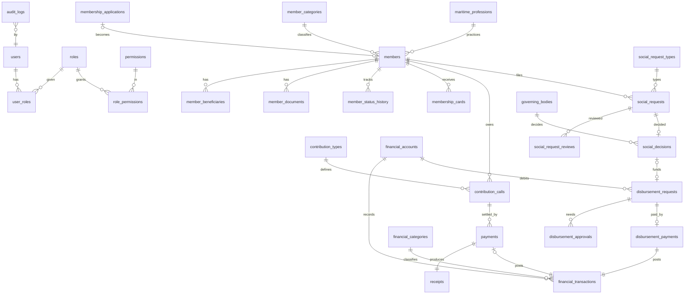

# 04 — Modélisation de la base de données

> MySQL 8 / MariaDB 10.6+, InnoDB, `utf8mb4_unicode_ci`, fuseau stocké en UTC et affiché en Africa/Abidjan (identiques, UTC+0, sans heure d'été).
> Statut : **proposition** — les migrations SQL versionnées (`database/migrations/NNNN_*.sql`) seront écrites à partir de ce schéma en lot L0+.

## 1. Conventions

| Convention | Règle |
|---|---|
| Clé primaire | `id BIGINT UNSIGNED AUTO_INCREMENT` |
| Clés étrangères | `<table_singulier>_id`, indexées, `ON DELETE RESTRICT` par défaut ; `CASCADE` uniquement pour les tables de détail sans valeur propre (ex. `menu_items`, `role_permissions`) |
| Horodatage | `created_at`, `updated_at` (TIMESTAMP) sur toutes les tables ; `created_by`, `updated_by` sur les tables métier |
| Suppression | **Logique** (`deleted_at`) sur les données métier (membres, partenaires, contenus) ; **jamais** de suppression sur finances, décisions et audit |
| Montants | `DECIMAL(15,2)`, devise `CHAR(3) DEFAULT 'XOF'` ; calculs en BCMath côté PHP |
| Références lisibles | `reference VARCHAR(30) UNIQUE` générée par séquence (`sequences` : année + compteur, verrouillée en transaction) |
| Énumérations métier | Statuts techniques de workflow en `VARCHAR(30)` + contrôle applicatif ; listes **métier** (VAL) en tables de référence administrables |
| Fichiers | Une table `files` unique (chemin privé/public, MIME, taille, hachage SHA-256) référencée par les tables métier |

## 2. Schéma relationnel du cœur (adhérents, finances, social)

Le **fonds de solidarité** est un `financial_accounts` de type `solidarity_fund` : ses mouvements sont les `financial_transactions` de ce compte. Cela garantit un suivi distinct (CDC art. 10) sans dupliquer la logique comptable. La table `solidarity_fund_transactions` de la liste indicative est donc remplacée par une **vue SQL** `v_solidarity_fund_transactions`.

## 3. Tables par domaine

### 3.1 Utilisateurs et sécurité

| Table | Colonnes principales | Contraintes / index |
|---|---|---|
| `users` | name, email, phone, password (hash), is_active, two_factor_secret (chiffré), last_login_at, member_id (nullable, si l'utilisateur est aussi membre), delegate_id (nullable) | UNIQUE(email) |
| `roles` | name, label, description, is_system | UNIQUE(name) |
| `permissions` | name (`module.action`), label, module | UNIQUE(name) |
| `role_permissions` | role_id, permission_id (CASCADE) | PK(role_id, permission_id) |
| `user_roles` | user_id, role_id (CASCADE), scope_zone_id NULL, scope_body_id NULL | PK(user_id, role_id) ; périmètre optionnel |
| `sessions` | id, user_id, ip, user_agent, payload, last_activity | INDEX(user_id) |
| `login_attempts` | email, ip, succeeded, created_at | INDEX(email, created_at) |
| `audit_logs` | user_id, action, auditable_type, auditable_id, old_values JSON, new_values JSON, ip, user_agent, reference, prev_hash, hash, created_at | **Aucun** update/delete applicatif ; INDEX(auditable_type, auditable_id), INDEX(created_at) ; utilisateur SQL applicatif sans droit `UPDATE/DELETE` sur cette table si l'hébergeur le permet |
| `sensitive_access_logs` | user_id, subject_type, subject_id, field_group (pièce d'identité, données médicales…), created_at | Journal des consultations sensibles |
| `settings` | group, key, value JSON, status (`non_configure` / `valide`), validated_by, validated_at, decision_ref | UNIQUE(group, key) — porte les paramètres VAL |
| `files` | disk (`private`/`public`), path, original_name, mime, size, sha256, uploaded_by | INDEX(sha256) |
| `sequences` | name, year, last_value | UNIQUE(name, year) |
| `notifications` | user_id, type, title, link, read_at | INDEX(user_id, read_at) |
| `schema_migrations` | version, applied_at, checksum | Migrations appliquées |
| `scheduled_runs` | task, started_at, finished_at, status | Verrou et suivi des tâches Cron |

### 3.2 CMS

| Table | Colonnes principales | Notes |
|---|---|---|
| `cms_pages` | parent_id, title, slug, template, blocks JSON, excerpt, featured_file_id, status, published_at, seo_title, seo_description, og_file_id, canonical_url, sort_order, author_id | UNIQUE(slug) ; INDEX(status, published_at) |
| `cms_menus` | name, location (`header`, `footer`…) | UNIQUE(location) |
| `cms_menu_items` | menu_id (CASCADE), parent_id, label, page_id / url, target, sort_order, is_active | — |
| `cms_articles` | title, slug, body (HTML purifié), excerpt, featured_file_id, category_id, author_id, status, published_at, archived_at, SEO… | UNIQUE(slug) |
| `cms_categories`, `cms_tags`, `cms_article_tag` | name, slug | — |
| `cms_media` | file_id, title, alt, caption, folder | Médias publics (images, PDF publics) |
| `cms_events` | title, slug, description, starts_at, ends_at, location, featured_file_id, status | — |
| `cms_documents` | title, category, file_id, published_at, status | Documents officiels publics |
| `cms_partners` | Vue publique alimentée par `partners.is_public` (pas de table séparée, évite la duplication) | — |
| `cms_galleries`, `cms_gallery_items` | Albums / photos | — |
| `cms_banners`, `cms_testimonials` | Bannières, témoignages (consentement obligatoire : `consent_file_id`) | Témoignages désactivés par défaut |
| `cms_forms`, `cms_form_submissions` | form_key, payload JSON, status (`nouveau`, `en_cours`, `traite`, `archive`), assigned_to, history JSON, ip | Contact, information, partenariat |

Les coordonnées, réseaux sociaux et pied de page sont des clés de `settings` (groupe `site`).

### 3.3 Adhérents

| Table | Colonnes principales | Notes |
|---|---|---|
| `member_categories` | name, is_active | VAL — pré-remplie avec les catégories de l'art. 5 |
| `maritime_professions`, `maritime_specialties` | name, parent | Référentiels administrables |
| `zones` | name, type (port, localité, région), parent_id | Rattachement géographique |
| `members` | member_number UNIQUE, last_name, first_names, sex, birth_date, birth_place, nationality, phone, phone_alt, email, address, zone_id, photo_file_id, id_document_type, id_document_number, category_id, profession_id, specialty_id, employment_status, employer, seaman_book_number, seaman_book_expiry, joined_at, status, status_changed_at, delegate_id, anonymized_at, deleted_at | INDEX(last_name, first_names), INDEX(status), INDEX(zone_id), INDEX(phone) ; FULLTEXT(last_name, first_names) |
| `member_beneficiaries` | member_id, last_name, first_names, relationship, birth_date, phone, file_id | Ayants droit |
| `member_documents` | member_id, type, file_id, verified_by, verified_at | Pièces privées |
| `member_status_history` | member_id, from_status, to_status, reason, decision_ref, changed_by, created_at | Ajout seul |
| `membership_applications` | reference, payload JSON (données saisies), status, reviewer_id, rejection_reason, member_id (si validée), source (`en_ligne`, `saisie`, `delegue`), ip | Distincte de `members` |
| `membership_application_files` | application_id, type, file_id | — |
| `membership_cards` | member_id, card_number, verify_token UNIQUE (aléatoire 32 o), issued_at, expires_at, revoked_at, printed_by | — |

### 3.4 Cotisations et finances

| Table | Colonnes principales | Notes |
|---|---|---|
| `contribution_types` | name, kind (`droit_adhesion`, `periodique`, `exceptionnelle`), amount DECIMAL **NULL**, periodicity NULL, authorization_ref, status (`non_configure`/`actif`), affects_account_id | Montant NULL tant que non validé (VAL V1–V2) |
| `contribution_calls` | member_id, contribution_type_id, period_label, period_start, period_end, amount_due, due_date, status (`appelee`, `partielle`, `payee`, `annulee`) | UNIQUE(member_id, contribution_type_id, period_start) |
| `payments` | reference, member_id, contribution_call_id NULL, amount, method (`especes`, `mobile_money`, `virement`, `cheque`), external_ref, paid_at, received_by, financial_transaction_id, idempotency_key UNIQUE | — |
| `receipts` | payment_id UNIQUE, receipt_number UNIQUE, file_id, issued_at, cancelled_at, cancel_reason | Annulation = contre-passation, jamais suppression |
| `financial_accounts` | name, type (`general`, `solidarity_fund`, `bank`, `cash`, `mobile_money`), currency, opening_balance, is_active | Le solde = opening + Σ transactions |
| `financial_categories` | name, direction (`recette`/`depense`), parent_id | Pré-remplie avec les ressources de l'art. 13 |
| `financial_transactions` | reference, account_id, category_id, direction, amount (>0), occurred_at, source_type/source_id (paiement, don, décaissement…), donor_partner_id NULL, description, authorization_ref, reversal_of_id NULL, recorded_by | **Jamais modifiée** : correction par écriture d'annulation (`reversal_of_id`) ; CHECK(amount > 0) |
| `financial_attachments` | attachable_type, attachable_id, file_id, label | Justificatifs |
| `budgets`, `budget_lines` | fiscal_year, category_id, amount_planned, adopted_ref | Budgets prévisionnels (art. 4 TG) |
| `commitments` | reference, account_id, category_id, amount, beneficiary, purpose, status | Engagements (art. 15) |
| `disbursement_requests` | reference, account_id, category_id, amount, beneficiary_name, beneficiary_member_id NULL, purpose, social_decision_id NULL, commitment_id NULL, revision INT, status, initiated_by, submitted_at, rejected_by, rejection_reason, cancelled_at | INDEX(status) ; CHECK(amount > 0) |
| `disbursement_revisions` | disbursement_request_id, revision, snapshot JSON, changed_by, reason | Historique des modifications |
| `disbursement_approvals` | disbursement_request_id, revision, approver_id, decision (`approve`/`reject`), comment, decided_at, invalidated_at | UNIQUE(disbursement_request_id, revision, approver_id) |
| `disbursement_payments` | disbursement_request_id **UNIQUE**, paid_at, method, external_ref, paid_by, financial_transaction_id, proof_file_id NOT NULL | Empêche le double paiement au niveau base |
| `approval_rules` | min_amount, max_amount NULL, approvals_required (≥ 2), eligible_permission, decision_ref | VAL V14 ; règle par défaut : 2 |

### 3.5 Actions sociales

| Table | Colonnes principales | Notes |
|---|---|---|
| `social_request_types` | name (décès, maladie, difficulté sociale, urgence, ayants droit, autre), is_financial_possible, criteria_text, ceiling_amount NULL, waiting_period_days NULL, deciding_body_id NULL, status | Critères/plafonds VAL, NULL par défaut |
| `social_requests` | reference, member_id, beneficiary_id NULL, type_id, received_at, channel, description, priority, assigned_to, status, closed_at, contains_medical_data | INDEX(status, priority) |
| `social_request_documents` | social_request_id, type, file_id | Privé |
| `social_request_reviews` | social_request_id, reviewer_id, opinion, recommended_amount NULL, comment | Avis d'instruction |
| `social_decisions` | social_request_id UNIQUE, governing_body_id, meeting_id NULL, decision (`accordee`/`refusee`), aid_kind (`financiere`, `orientation`, `accompagnement`, `materielle`), amount NULL, reason, decided_at, recorded_by | — |
| `social_request_events` | social_request_id, from_status, to_status, user_id, comment | Historique |

### 3.6 Emploi et formation

| Table | Colonnes principales |
|---|---|
| `employment_offers` | reference, title, partner_id NULL, company_name, offer_type (`emploi`, `embarquement`), position_type, specialty_id, qualifications, location, published_at, deadline, how_to_apply, status (`brouillon`, `a_verifier`, `publiee`, `expiree`, `archivee`), verified_by |
| `employment_applications` | offer_id, member_id NULL, applicant_name, phone, email, file_id NULL, status (`recue`, `transmise`, `retenue`, `non_retenue`), notes |
| `job_placements` | application_id, partner_id, placed_at, outcome — mises en relation suivies |
| `training_centers` | name, partner_id NULL, address, contacts, specialties |
| `training_opportunities` | title, center_id, description, starts_at, deadline, status, is_public |
| `training_guidance_requests` | member_id, opportunity_id NULL, need, status, handled_by |
| `veteran_followups` | member_id, career_summary, admin_situation, needs, last_contact_at, handled_by — suivi anciens marins (sans prestation financière propre) |

### 3.7 Partenariats

| Table | Colonnes principales |
|---|---|
| `partner_categories` | name (armement, pêche industrielle, offshore, syndicat, association professionnelle, établissement sanitaire, centre de formation, institution publique, institution privée, ONG) |
| `partners` | name, category_id, address, phone, email, website, contact_name, contact_role, logo_file_id, status (`prospect`, `actif`, `suspendu`, `termine`), is_public |
| `partnership_agreements` | partner_id, reference, subject, mutual_commitments, start_date, duration_months, end_date, renewal_date, termination_terms, follow_up_terms, signed_file_id, status |
| `partnership_activities` | partner_id, agreement_id NULL, type (échange, réunion, action), occurred_at, summary, user_id |

### 3.8 Gouvernance, délégués

| Table | Colonnes principales |
|---|---|
| `governing_bodies` | name, type (AG, CA, BE, contrôle, commission, délégation), parent_id, description |
| `positions` | body_id, title (PCA, 1er VP, SG, TG…), description — **sans pouvoir implicite** |
| `mandates` | position_id, member_id / user_id, start_date, end_date, appointment_ref |
| `commissions` | governing_body_id (type commission), mandate_text |
| `delegates` | member_id, user_id NULL, kind (`delegue`, `point_focal`), zone_id, start_date, end_date, status |
| `mission_orders` | delegate_id, reference, objectives, start_date, end_date, issued_by, file_id |
| `mission_reports` | delegate_id, mission_order_id NULL, period_start, period_end, activities, members_recruited, difficulties, actions, submitted_at, reviewed_by |
| `mobilization_activities` | type (rencontre, sensibilisation, campagne), zone_id, occurred_at, participants_count, summary, delegate_id NULL |
| `meetings` | governing_body_id, title, type (ordinaire, extraordinaire), scheduled_at, location, convocation_sent_at, status |
| `meeting_agendas` | meeting_id, position, item |
| `meeting_attendees` | meeting_id, user_id / member_id, presence |
| `meeting_minutes` | meeting_id UNIQUE, body, file_id, approved_at |
| `decisions` | reference, meeting_id NULL, governing_body_id, title, text, adopted_at, responsible_user_id, due_date, status |
| `decision_followups` | decision_id, note, progress (`non_demarre`, `en_cours`, `execute`, `abandonne`), user_id |
| `communication_campaigns` | title, channel, starts_at, ends_at, audience, results — indicateur « Communication » (art. 20) |
| `control_reports` | title, period, body_id, file_id — indicateur « Transparence » (art. 20) |

### 3.9 Discipline

| Table | Colonnes principales |
|---|---|
| `disciplinary_measures` | name, source_article, is_active — **vide par défaut** (VAL V9) |
| `disciplinary_cases` | reference, subject_type (membre / dirigeant), subject_id, reported_by, facts, reported_at, notified_at, observation_deadline, status |
| `disciplinary_case_files` | case_id, file_id |
| `disciplinary_observations` | case_id, author (la personne concernée ou son représentant), received_at, content, file_id |
| `disciplinary_decisions` | case_id UNIQUE, governing_body_id, measure_id NULL (aucune mesure possible), reasoning, decided_at, decision_ref |

### 3.10 Espace adhérent

| Table | Colonnes principales | Notes |
|---|---|---|
| `member_accounts` | member_id **UNIQUE**, login_phone, login_email NULL, password (hash Argon2id), status (`en_attente`, `actif`, `verrouille`, `desactive`), activated_at, last_login_at, failed_attempts, locked_until | Séparée de `users` : deux mondes d'authentification distincts |
| `member_activation_codes` | member_account_id, code_hash, purpose (`activation`, `reinitialisation`), delivery (`email`, `lettre`), issued_by NULL, expires_at, used_at | Usage unique ; le code en clair n'est jamais stocké |
| `member_change_requests` | member_id, fields JSON (avant/après), status (`soumise`, `acceptee`, `refusee`), reviewed_by, reason | Corrections demandées par l'adhérent |
| `member_messages` | member_id, title, body, link, read_at | Notifications à l'adhérent (demande avancée, reçu disponible) |

Ajouts : `social_requests.channel` accepte `espace_adherent` ; `social_requests.member_visible_status` est **calculé** à partir du statut interne (table de correspondance), pour ne jamais exposer les étapes internes ; `social_decisions.member_message` est le texte de décision communiqué à l'adhérent.

## 4. Choix importants expliqués

1. **Demande d'adhésion ≠ membre** : `membership_applications` stocke la saisie brute ; le membre n'existe qu'après validation (CMD § 6.3).
2. **Écritures financières immuables** : on n'efface ni ne modifie une transaction ; on la contre-passe. Le solde est toujours recalculable et auditable.
3. **Fonds de solidarité = compte dédié** : séparation stricte (CDC art. 10), rapports par simple filtre.
4. **Double paiement impossible en base** : `UNIQUE(disbursement_request_id)` dans `disbursement_payments`, en plus du contrôle applicatif.
5. **Révisions de décaissement** : chaque approbation est liée à une révision ; une modification substantielle crée une nouvelle révision et rend les anciennes approbations caduques sans les effacer.
6. **Paramètres VAL avec statut** : `settings.status = non_configure` empêche l'usage d'une règle non validée et affiche un bandeau « paramètre en attente de validation par les instances ».
7. **Pas de pouvoir par titre** : `positions` décrit une fonction, les pouvoirs viennent uniquement des permissions.
8. **Dimensionnement** : 2 000 membres, ~24 000 appels de cotisation/an : volumes faibles pour MySQL ; les index listés suffisent.
9. **Comptes adhérents séparés des comptes du personnel** : une faille ou une erreur de droits côté adhérent ne peut pas ouvrir l'administration ; les deux populations ont des règles de mot de passe et d'expiration distinctes.
